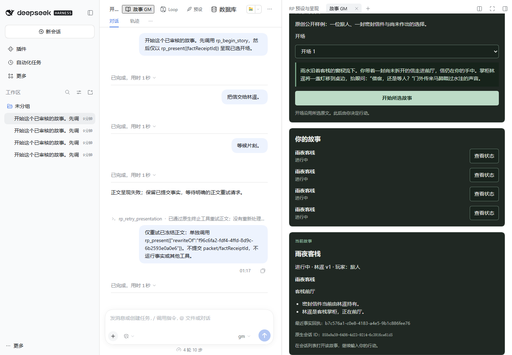

# DSH RP GM

一个供所有故事共用的原生 GM 插件。选择已审阅的角色、玩家身份与开场后，主 Agent 决定并提交事实，Database 保存状态，LastStep 呈现正文；Context 可选参与选材。无需为每张卡编写 runtime。

**0.2.0** 增加默认关闭、每故事独立的事实审批，以及事实／正文两个重新生成入口。候选、真实 owner 决策与写作各有独立恢复步骤。原有开局、分支／回退和恢复执行门保留。[审批与重生说明](docs/fact-review.md) 记录新流程；[既有原生验收证据](docs/native-acceptance.md) 的受测范围仍以其中明确版本为准。

## 安装与依赖

| 组件 | 要求 |
|---|---|
| 官方 DSH | `0.2.1-rc.3` 起的受支持 0.2.x；本插件未验收 rc.2 |
| Node.js | 24 或更新受支持版本 |
| [RP Database 0.2.0](https://github.com/LiweiDonVee/dsh-rp-database/releases/tag/v0.2.0) | 必需，提供 `apiVersion === 2`、原子事实回执与 v2 来源绑定 |
| [RP LastStep 0.3.0](https://github.com/LiweiDonVee/dsh-rp-last-step/releases/tag/v0.3.0) | 必需，提供事实回执呈现、builtin profile 与因果分支继承 |
| [RP Context 0.2.0](https://github.com/LiweiDonVee/dsh-rp-context/releases/tag/v0.2.0) | 可选，通过材料 facade 选材 |
| [Loop Studio 0.1.0](https://github.com/LiweiDonVee/dsh-loop-studio/releases/tag/v0.1.0) | 可选，沿用主 Agent 的模型路由 |

事实审批／事实重生需要 Database 0.3（`factReview=1`）和 LastStep 0.4（`narrativeRevisions=1`）。旧 Database 下保留审批关闭的旧路径，不传入未知 capture 字段。新版本正文材料投影使用 LastStep 的有效历史；新流程可选配 Context 0.3。本版本本地安装包名为 `dsh-rp-gm-0.2.0.tgz`；下面旧发布链接用于既有 0.1 安装。

从 [0.1.0 发布页](https://github.com/LiweiDonVee/dsh-rp-gm/releases/tag/v0.1.0) 下载 [dsh-rp-gm-0.1.0.tgz](https://github.com/LiweiDonVee/dsh-rp-gm/releases/download/v0.1.0/dsh-rp-gm-0.1.0.tgz)，并从上表发布页下载 Database 和 LastStep 的对应 tgz。将三个文件放在同一下载目录，在该目录打开终端；完全退出 DSH 后安装，再重启：

```powershell
dsh plugin --profile desktop add ./dsh-rp-database-0.2.0.tgz
dsh plugin --profile desktop add ./dsh-rp-last-step-0.3.0.tgz
dsh plugin --profile desktop add ./dsh-rp-gm-0.1.0.tgz
```

Web profile 将 desktop 改为 web。Windows 未配置 PATH 时，可用官方启动器：

```powershell
$gmCli = Join-Path $env:LOCALAPPDATA 'Programs/DeepSeek Harness/resources/runtime/cli/bin/dsh.cmd'
& $gmCli plugin --profile desktop add ./dsh-rp-database-0.2.0.tgz
& $gmCli plugin --profile desktop add ./dsh-rp-last-step-0.3.0.tgz
& $gmCli plugin --profile desktop add ./dsh-rp-gm-0.1.0.tgz
```

在宿主正常配置页选择可用的主模型，并将 tools 模式设为 native。writer／模块组装模型沿用 LastStep 的配置和可选 Loop 路由。GM 不保存 provider 凭据，也不自带付费模型配置。本地模型验收覆盖实际工具、日志与 owner 服务；故事质量仍取决于选用的模型。

## 不借助 StoryKit 开始

1. 点击会话顶部 **故事 GM**，或右侧页签中的 **故事 GM**。
2. 阅读原创公开样例“雨夜客栈”，在两个开场中选一个。
3. 点击 **开始所选故事**。插件固定资料版本、建立空 sources 绑定和 @session 初始状态、绑定 ready profile，随后提交一次普通原生首轮提示。
4. 面板显示原生会话 ID；在会话列表打开该故事，输入你的行动。

开场原文由真正的 `rp_begin_story` → `rp_present({factReceiptId})` 原生工具流程呈现，主模型不能替换所选开场。只有 canonical 成功呈现后，故事状态才变为进行中。示例对话是风格参考，不算已经发生的事件。

GM 面板显示场景与事实。正文、冻结材料、失败重试和候选稿在 LastStep 的 **最后一步** 面板阅读；可选 Studio 提供沉浸阅读入口。



依赖未安装时，故事库和诊断仍可打开，启动操作返回明确错误。连接中断时点击 **重试这个开局**：面板保留相同 launchId 和开场；启动日志只允许同一份已审阅输入继续，不会因重试另建会话或重置事实。完整页面关闭后，其他内容来源的调用方仍须保留原始 owner 请求以恢复部分启动。

## 事实与正文

- `rp_gm_state` 读取当前场景、已确认事实、Database revision 和当前回执。
- `rp_begin_story` 从绑定和 Database 取得已审阅开场状态，重复恢复返回同一有效开场回执。
- `rp_commit_turn` 校验 scene/facts，按实际原生工具来源提交一个原子批次。相同重试返回稳定回执；冲突返回 `TURN_ALREADY_COMMITTED` 与 `receiptId`。
- `rp_propose_turn` 在审批开启时作为唯一、直接的终止调用保存候选并结束回合。候选不写权威 scene/facts，不运行 Context、组装或 writer，也不等待一个人类 Promise。
- `rp_present({factReceiptId})` 单独终结呈现。GM 交给 LastStep 固定的 title、character、persona、examples 和公开方向包，Context 缺席时这些固定资料也会保留。

人类 readOnly／disabled／required 策略始终有效。注册事实只由事实 facade 提交；材料、临时备注和示例不能自行升级为发生过的事件。角色固定 description/personality/scenario 是来源资料，当前 Database 事实和已提交方向包优先。没有数值 RPG 引擎、NPC ACL、每卡代码或第二套世界真值。

writer 失败后事实仍已提交。继续使用原事实回执；已有冻结失败稿通过 LastStep 的 `rewriteOf` 流程重试。LastStep 的原生 **仅重试正文** 可以包含一次受限主模型分发和一次 writer 请求，复用原冻结材料，事实和模块组装不重跑。成功正文的表达候选使用 LastStep Draft API；同一事实回执不能以新工具上下文再次发表正式正文。

新面板的 **重新生成正文** 调用 LastStep 的 append-only 正文修订，不改事实。**重试事实／重新生成事实** 则从 Database 保存的回合前状态、玩家输入与真实工具结果进行一次无工具模型请求；新版事实会供下一轮使用，旧版保留审计。工具副作用和原先固定工作操作不会重放，原生日志不被替换。关闭故事开关不会批准已存在的待审候选。

## 分支、回退与恢复执行门

`forkStory` 使用公开 session/fork。`rollbackStory` 沿真实 MessageId 和双队列入队／领取记录，选择目标事实回合输入最初入队前、队列为空的最新闭合前缀，创建子故事并保留原分支和所有先前完成的回合。若提前排队或共享输入无法用一个前缀隔离，返回 `ROLLBACK_UNAVAILABLE`，不创建子故事。不会清理私有 inbox、修改原日志或回退开场到非法空 head。子故事在 Database 前缀、LastStep 正确历史 profile/overlay 和可选 Context 计划就绪后才可继续。能力返回 `{rollback,fork,autoplay:false}`；通用 GM 没有旧 RP autoplay 驱动。

StoryKit 可在恢复前调用 plugin-only `reserveRestore`，占住已预检的目标 ID。reserved/restoring 状态会拒绝原生 play；`activateRestored` 必须验证同一 job 的绑定、真实 Agent、Database 状态、当前 ready profile 和应有的 canonical 开场，再解除执行门。两个方法不提交 prompt 或重播开场。

`StoryBinding.profile` 记录开局固定版本，作为来源保留。后续换风格与前缀继承由 LastStep 保存当前绑定；GM 不把它改回开局风格。恢复须保留初始版本并验证 LastStep 实际当前绑定可用。

`StoryBinding.sources` 同样只记录开局来源。当前资料组合从 Database 的 `effectiveV2` 读取；owner 追加文档或兼容重配后，GM 不同步第二份当前组合，也不会回绑开局列表。保存与恢复校验初始库的精确版本仍可读取，并验证 Database 当前注册事实、有效状态和真实回执。StoryKit 用已有 additionalDatabaseRefs 保留初始库版本。

GM 的四个 transfer 方法只传自己的 metadata。完整故事保存与恢复由 StoryKit 协调各 owner 和公开宿主 persistence；不能只导入 GM 就报告故事恢复完成。新建目标须先追加完整原事件并 flush，再记录创建归属，随后完成读取和冷校验；创建检查点不等于恢复完成。跨存储恢复中断时保持执行门。若宿主已创建 Session 而协调器尚未记录创建归属即崩溃，不能仅因日志相同接管已有 ID，须保留冲突供 owner 处理。

## 服务与 owner 路由

可选服务名 `rpGM`，`apiVersion:1`：

```text
startStory({launchId,title,character,persona,opening,examples,sources,profile?,initialScene,initialFacts,signal?})
binding({sessionId,signal?})
storyState({sessionId,agent?,signal?})
listStories({signal?})
presentation({sessionId,agent,factReceiptId,signal?})
forkStory({sessionId,atSeq?,signal?})
rollbackStory({sessionId,signal?})
reserveRestore({restoreId,sessionIds,signal?})
activateRestored({restoreId,sessionIds,signal?})
contentRevision({signal?}) -> {revision}
exportState({sessionIds,signal?}) -> {schemaVersion:1,revision,payload}
preflightRestore({sessionIds,state,signal?}) -> {supported,conflicts,requirements}
restoreState({restoreId,sessionIds,state,expectedRevision,signal?}) -> {revision,restoredSessionIds}
reviewState({sessionId,signal?})
configureReview({sessionId,enabled,expectedRevision,signal?})
decideFacts({sessionId,roundId,candidateId,action,custom?,operationId,expectedRoundVersion,expectedDatabaseRevision,signal?})
resumeFactDecision({sessionId,operationId,signal?})
regenerateFacts({sessionId,roundId,operationId,expectedRoundVersion,instruction?,signal?})
resumeFactGeneration({sessionId,operationId,signal?})
cancelFactGeneration({sessionId,jobId,signal?})
resumeFactPresentation({sessionId,roundId,operationId,signal?})
```

`presentation` 是 LastStep 的受信接口。它拒绝其他故事／失效来源／被后续事实取代的回执，以及已有正式呈现的回执；不会把 receiptId 塞进旧 packet 白名单。native 工具不接受 session、owner、source、turnKey 或 stage 参数。

`preflightRestore` 不要求目标 Session 已存在。`restoreState` 在 owner 队列中先校验结构、revision、真实 canonical 来源和已恢复依赖，再一次写入 restoring metadata；失败不改变数据或 revision。同 restoreId 与相同 payload/set 幂等，不同输入返回 `RESTORE_ID_CONFLICT`。安全无 prompt resume 后才执行 Agent 专属回执验证并 activate。`exportState` 取本 store 原子快照，检查生成状态与前后来源/revision；协调器持有跨 owner maintenance 锁，GM 不嵌套申请。

原生 owner Connection 路由：POST `/api/rp-gm/request`（library、startSample、startStory、state、binding）和 GET `/api/rp-gm/events?sessionId=…`。SSE 只有变更元数据，正文和事实通过授权 owner request 读取。具体边界见 [架构说明](docs/architecture.md)。

新增能力为 `capabilities.factReview=1`、`factRegeneration=1`，API version 仍为 1。HTTP 还提供上列静态 review 动作；仅决定动作使用 `{action:'decideFacts',decision:{…原 owner 参数}}`，内层 `action` 是 approve/custom/cancel。浏览器和模型都不能提交 source、requestHash 或 stage。正文按钮直接请求 LastStep 原有 `/api/rp-last-step/request`，没有 GM 正文代理方法。

## 数据与备份

GM 自己仅保存 `${DSH_HOME}/app-data/rp-gm/state.json` 的 binding、启动进度、指纹、回执／来源指针、审批设置、不可变 owner 请求、生成／呈现协调信息和恢复执行门。自定义 payload 是该人类请求的不可变内容，不是第二份当前事实。它不保存 initialScene、initialFacts 或可变当前世界副本。没有 DSH_HOME 时使用用户 `.dsh`。

备份时关闭宿主，连同原生日志和 Database、Context、LastStep、Loop、StoryKit 各自的数据一起保留。仅复制 GM metadata 不能恢复世界状态、正文或依赖资产。动态 preset 每次加载重新注册，卸载时释放 disposer；不是写入 profile 的永久声明。

## 开发与验证

```powershell
pnpm install --frozen-lockfile
pnpm check
pnpm package
```

package 生成 `artifacts/dsh-rp-gm-0.2.0.tgz` 与 SHA256SUMS，并检查 tarball 中独立 bundle 的 host/client 可以加载、没有 sibling workspace 依赖。从源码安装 GM 时，在仓库根目录执行 `dsh plugin --profile desktop add ./artifacts/dsh-rp-gm-0.2.0.tgz`。新流程需要上述具备 review/revision 能力的依赖。测试覆盖启动响应丢失、重复提交、政策、分支、回退、provider 原子性、恢复执行门、审批／生成恢复和原生面板。保留的 [native runner](scripts/native/README.md) 记录既有验收；本次新增流程仍需实际 reviewed 产品包的组合验收。

MIT License。
